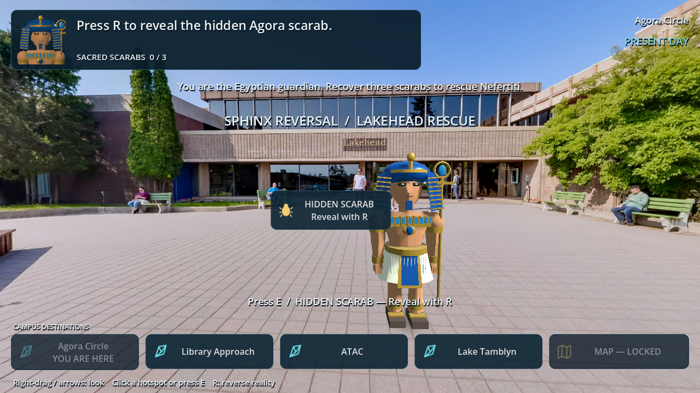
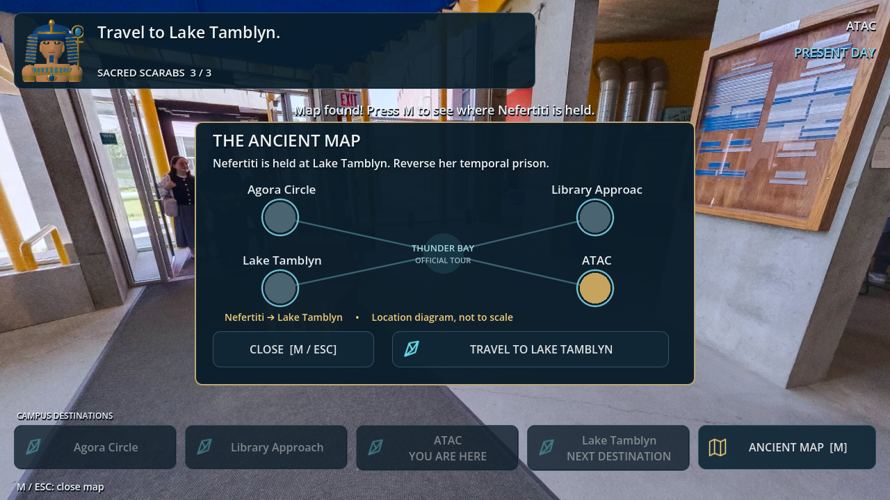

# Latest: developed user-uploaded Three.js game

The uploaded SPHINX_REVERSAL project is developed in [SPHINX_REVERSAL_WEB](SPHINX_REVERSAL_WEB/). Playable animated quadruped Sphinx, mouse orbit and wheel zoom, clearer mission marker, compact HUD, optimized static geometry and the original complete reversal quest.

- [Small ready-to-play ZIP](https://github.com/eldelngaty/EGYPTIANLAKEHEAD/raw/repair/360-adventure-ux/downloads/SPHINX_REVERSAL_Play.zip): extract and open PLAY_SPHINX.html in Chrome/Edge; no installation or server.
- [Complete updated source ZIP](https://github.com/eldelngaty/EGYPTIANLAKEHEAD/raw/repair/360-adventure-ux/downloads/SPHINX_REVERSAL_Project.zip).
- [Actual screenshots, recording and test evidence](SPHINX_REVERSAL_WEB/qa/current/).

24 geometry checks; 20/20 full actual-input completion against source and again against network-disabled standalone HTML; final regression 30/30 and final presentation checks. Native Windows launching/human playtesting remain untested. Earlier Godot work is preserved below; stable main is unchanged.

---

# Latest: third-person Sphinx adventure

A four-legged playable Sphinx in the existing walkable campus. Mouse look, wheel zoom, accelerated movement, compact mission HUD and the full rescue quest. PR #1 remains unmerged; stable main is preserved.

- [Windows x64 ZIP](https://github.com/eldelngaty/EGYPTIANLAKEHEAD/raw/repair/360-adventure-ux/downloads/Sphinx_Adventure_Windows_x64.zip)
- [Complete Godot 4.7.2 project ZIP](https://github.com/eldelngaty/EGYPTIANLAKEHEAD/raw/repair/360-adventure-ux/downloads/Sphinx_Adventure_Project.zip)
- [Actual screenshots](screenshots/adventure/)
- [Actual gameplay recording](https://github.com/eldelngaty/EGYPTIANLAKEHEAD/raw/repair/360-adventure-ux/downloads/Sphinx_Adventure_Gameplay.mp4)
- [Controls, validation and limitations](GAME_GODOT_V5_RUNNING_BASE/ADVENTURE_RELEASE.md)

The compact modeled campus is an adaptation from official references, not an exact campus reconstruction. Photographic references remain optional. Native Windows execution has not been tested on this Linux runner.

---

# Sphinx Reversal — Lakehead Rescue / playable repair

[Windows x64 game](https://github.com/eldelngaty/EGYPTIANLAKEHEAD/raw/refs/heads/repair/360-adventure-ux/downloads/Sphinx_Reversal_Playable_Repair_Windows_x64.zip) · [Complete Godot project](https://github.com/eldelngaty/EGYPTIANLAKEHEAD/raw/refs/heads/repair/360-adventure-ux/downloads/Sphinx_Reversal_Playable_Repair_Project.zip)

Windows: extract the ZIP and run `SphinxReversal.exe`; Godot is not required. Source: open `GAME_GODOT_V5_RUNNING_BASE/project.godot` in **Godot 4.7.2** and press F5.

This continues the same four authentic Lakehead panoramas. Exploration is now a location-based, first-person 360° adventure: right-drag to look, click large hotspots, press E on a highlighted target, and use R to reverse time. Named campus destinations remain visible; the next destination is highlighted. There is no fake small-radius walking or extra reach requirement.

The guardian has a newly authored blue-and-gold nemes, carved face, collar, kilt, hands, sandals, staff and limb pivots. An opening shot, live 3D HUD portrait and rescue/victory presentation keep the hero visible without placing a walking miniature over every photo. Nefertiti has a distinct tall blue crown.

Three short reversal encounters reveal the Agora scarab, restore the Library echo passage, and open ATAC's time lock. The same three-scarab → 3–2–1 altar → golden key → map → Lake Tamblyn → prison reversal → rescue quest remains. A graphical map and restart button complete the flow.

Navigation selects named peers verified in official Thunder Bay tour 52 / parent group 51. It does not invent adjacency from scene numbers or claim direct walking paths. Photo provenance and user-confirmed redistribution permission remain in `assets/tour/manifest.json` and `tour_evidence/`.

Validation uses Godot 4.7.2: 51 public-input completion checks, 51 asset/navigation/layout checks, and 15 legacy logic checks. The final Windows EXE's embedded game data also passes the public-input flow using the Linux Godot runner. Graphical execution captures the actual interface and characters; this is automation plus screenshot review, **not a real-user usability study**. Windows PE export is supplied, but native Windows execution and physical audio/GPU performance remain untested here.




Tests from the repository root:
```
godot --headless --path GAME_GODOT_V5_RUNNING_BASE --editor --import --quit
godot --headless --path GAME_GODOT_V5_RUNNING_BASE --script ../validation/tour_gameplay_smoke.gd
godot --headless --path GAME_GODOT_V5_RUNNING_BASE --script ../validation/human_input_smoke.gd
```
