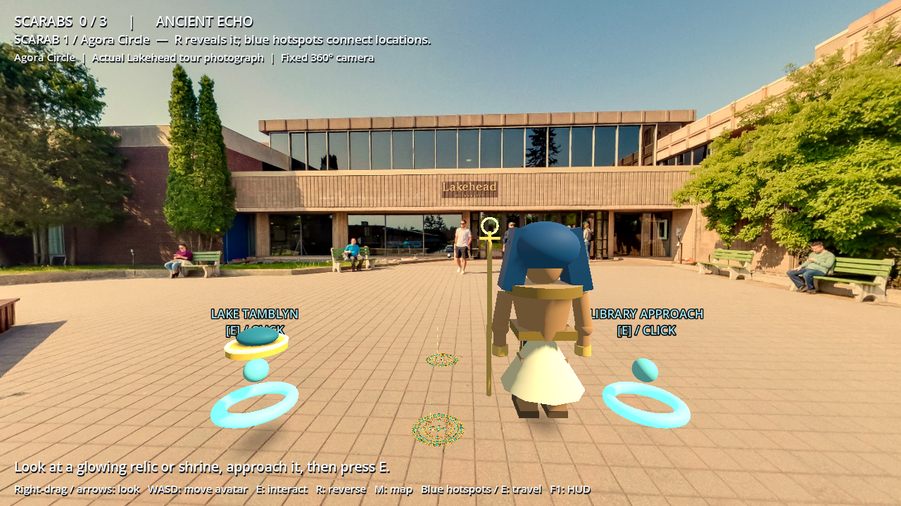
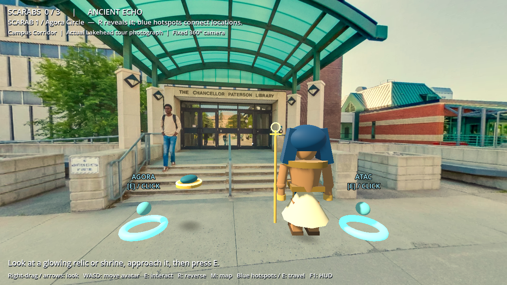
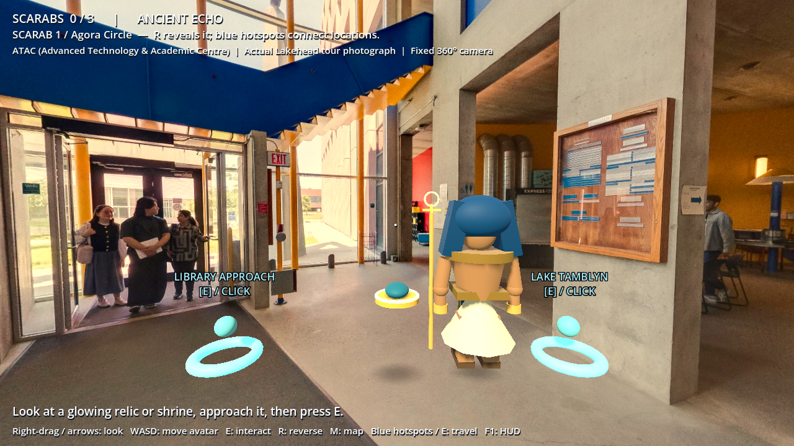

# Sphinx Reversal — REAL Lakehead Virtual Tour Edition

**[Download the complete Godot project ZIP](https://github.com/eldelngaty/EGYPTIANLAKEHEAD/raw/refs/heads/main/downloads/Sphinx_Reversal_REAL_LAKEHEAD_TOUR.zip)**

Open `GAME_GODOT_V5_RUNNING_BASE/project.godot` and press F5. The real photographic tour is now the default, available offline; no downloader or account is needed to play.

Four actual Lakehead/Circuit panoramas are reconstructed from 96 source tiles: Agora Circle, Campus Corridor at the Paterson Library entrance, ATAC interior, and Lake Tamblyn. Scene IDs, cube IDs, API metadata, source URLs and file hashes are in [the manifest](GAME_GODOT_V5_RUNNING_BASE/assets/tour/manifest.json); metadata and seam checks are in [tour_evidence](tour_evidence). The separate library gallery photograph is labeled as a photograph, not a panorama.

Right-drag or arrows to look; WASD moves the nearby 3D pharaoh; E interacts; R reverses reality; M opens the discovered map. Click the blue hotspots, or look at them and press E, to travel between camera locations. Collect scarabs in Agora, the library approach and ATAC; return to Agora for 3–2–1; use the key and map in ATAC; rescue Nefertiti at Lake Tamblyn.

This is a hybrid photographic/3D game: the photo camera stays fixed, nearby avatar movement is limited to 3.8m, and game-authored hotspots connect verified viewpoints. It is not a free-roam photogrammetric campus reconstruction. Photo scenery and photographed people are static; the pharaoh, scarabs, shrine, chest, map, bridge and queen are separate 3D objects.

Validation on Godot 4.6.3: headless import passed; 41/41 quest checks passed for source and packaged PCK; the 15 legacy checks passed; actual OpenGL screenshots were captured from the PCK. Godot 4.7, Windows execution, hardware-GPU performance and audible output were not tested. Windows export templates were absent; no EXE is supplied. [PCK build](build/SphinxReversal_RealTour.pck) requires a matching Godot engine.

Source imagery: Lakehead University / Circuit Virtual Tours. Redistribution is based on the user's explicit confirmation of permission for ZIP and GitHub publication; no public/open asset license or ownership is claimed.

